# 나만의 파이썬 퀴즈 게임

Python 기초 문법과 Git 사용법을 익히기 위해 만든 콘솔 기반 퀴즈 게임입니다.  
사용자는 등록된 퀴즈를 풀거나 새로운 문제를 추가할 수 있으며, 퀴즈와 점수 기록은 JSON 파일에 저장되어 프로그램을 다시 실행해도 유지됩니다.

## 1. 프로젝트 개요

이 프로젝트는 파이썬의 기본 문법을 실제 프로그램에 적용하는 것을 목표로 제작했습니다.

- **프로젝트 유형:** Python 콘솔 애플리케이션
- **퀴즈 주제:** Python 및 Git 기초
- **주요 기술:** Python, 클래스와 객체, 예외 처리, JSON 파일 입출력, Git/GitHub
- **외부 라이브러리:** 사용하지 않음 (Python 표준 라이브러리만 사용)
- **기본 제공 퀴즈:** 8개 (`state.json`의 `quizzes` 항목에 등록)

### 퀴즈 주제 선정 이유

개발 입문 과정에서 자주 사용하는 Python 문법과 Git 명령어를 문제로 구성했습니다.  
문제를 풀면서 변수, 리스트, 조건문, 반복문, 함수와 같은 파이썬 기초 개념을 복습하고, `git status`, `git branch`, `git remote -v` 등의 Git 명령어도 함께 익힐 수 있도록 주제를 선정했습니다.

### 기본 퀴즈 8개 구성

| 번호 | 분류 | 문제 요약 | 정답 키워드 |
| --- | --- | --- | --- |
| 1 | Python | 변수 대입 연산자 | `=` |
| 2 | Python | 리스트 길이를 구하는 함수 | `len` |
| 3 | Python | 조건문 키워드 | `if` |
| 4 | Python | 반복문 키워드 | `for` |
| 5 | Python | 함수 정의 키워드 | `def` |
| 6 | Python | `main.py` 실행 명령어 | `python main.py` |
| 7 | Git | 원격 저장소 주소 확인 명령어 | `git remote -v` |
| 8 | Python | 주석 기호 | `#` |

## 2. 개발 환경

| 항목     | 내용                        |
| ------ | ------------------------- |
| 운영체제   | Windows                   |
| 언어     | Python 3.10 이상            |
| 개발 도구  | Visual Studio Code 또는 터미널 |
| 실행 환경  | PowerShell                |
| 데이터 저장 | JSON (UTF-8)              |
| 버전 관리  | Git / GitHub              |

개발 환경 확인 화면:

[](https://github.com/kodisei889-dev/kodisei-E1-2/blob/main/docs/screenshots/python-version.png)

> 개발 당시 Windows에서 `python` 명령이 Microsoft Store 실행 별칭으로 연결되는 문제가 있었습니다. 해당 환경에서는 Python Launcher 명령인 `py`로 실행했습니다.

`python main.py` 실행 시 Microsoft Store 별칭 오류가 발생한 화면:

[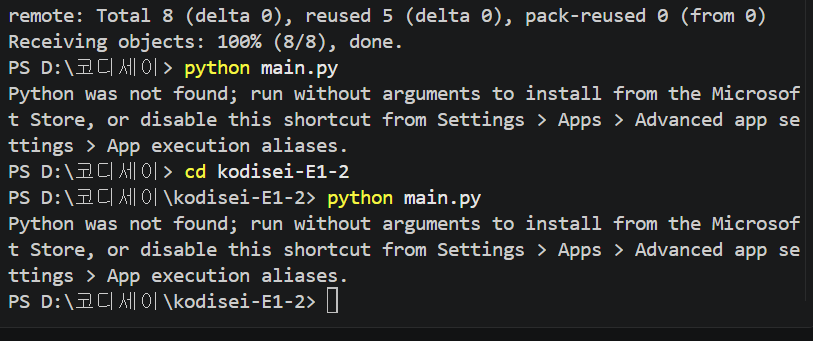](https://github.com/kodisei889-dev/kodisei-E1-2/blob/main/pic/pic1%20%282%29.png)

## 3. 실행 방법

### 3-1. 저장소 복제

```
git clone https://github.com/kodisei889-dev/kodisei-E1-2.git
cd kodisei-E1-2
```

### 3-2. Python 버전 확인

```
py --version
```

Python 3.10 이상이 설치되어 있어야 합니다.

### 3-3. 프로그램 실행

Windows PowerShell에서는 다음 명령어로 실행할 수 있습니다.

```
py main.py
```

`python` 명령이 정상적으로 등록된 환경이라면 아래 명령어도 사용할 수 있습니다.

```
python main.py
```

별도의 패키지 설치는 필요하지 않습니다.

### 3-4. 실행 예시 (명령 + 출력)

```
PS D:\코디세이\kodisei-E1-2> py main.py

===== 퀴즈 게임 =====
1. 퀴즈 풀기
2. 퀴즈 추가
3. 퀴즈 목록 보기
4. 최고 점수 확인
5. 퀴즈 삭제
6. 점수 기록 히스토리
0. 종료
메뉴 번호를 선택하세요:
```

메뉴 번호를 입력하면 해당 기능이 실행되고, `0`을 입력하면 데이터를 저장한 뒤 종료됩니다.  
(실제 문구는 최신 `main.py` 출력 기준이며, 실행 화면은 [12. 실행 화면](#12-실행-화면)에서 확인할 수 있습니다.)

## 4. 주요 기능

프로그램 메뉴에서 번호를 입력해 기능을 선택합니다.

| 메뉴 | 기능         | 설명                                |
| --- | ---------- | --------------------------------- |
| 1  | 퀴즈 풀기      | 전체 문제 또는 원하는 문제 수만큼 랜덤으로 출제       |
| 2  | 퀴즈 추가      | 문제, 선택지 4개, 정답 번호, 힌트 등록          |
| 3  | 퀴즈 목록 보기   | 등록된 문제와 선택지, 정답 및 힌트 확인           |
| 4  | 최고 점수 확인   | 저장된 최고 점수 확인                      |
| 5  | 퀴즈 삭제      | 선택한 퀴즈 삭제 후 JSON 파일에 반영           |
| 6  | 점수 기록 히스토리 | 게임 날짜/시간, 푼 문제 수, 점수, 힌트 사용 횟수 확인 |
| 0  | 종료         | 데이터를 저장하고 프로그램 종료                 |

### 4-1. 퀴즈 출제 및 문제 수 선택

- 등록된 문제 중 풀 문제 수를 선택할 수 있습니다.
- `0`을 선택하면 전체 문제를 풉니다.
- 문제 순서는 무작위로 섞입니다.
- 정답 또는 오답 여부를 즉시 확인할 수 있습니다.

### 4-2. 힌트 및 점수 계산

각 퀴즈에는 힌트가 포함될 수 있으며, 문제를 푸는 도중 `0`을 입력하면 힌트를 확인할 수 있습니다.

점수 규칙은 다음과 같습니다.

| 풀이 결과      | 점수 변화               |
| ---------- | ------------------- |
| 힌트 없이 정답   | +1점                 |
| 힌트 사용 후 정답 | 0점 (정답 +1점, 힌트 -1점) |
| 힌트 없이 오답   | 0점                  |
| 힌트 사용 후 오답 | -1점                 |

힌트는 한 문제에서 한 번만 사용할 수 있습니다. 힌트 사용에 따른 감점은 정답 여부와 관계없이 적용됩니다.

### 4-3. 퀴즈 추가 및 삭제

- 문제와 선택지 4개를 입력해 새 퀴즈를 등록합니다.
- 정답 번호는 1~4 중에서 선택합니다.
- 힌트는 선택적으로 입력할 수 있습니다.
- 삭제할 퀴즈 번호를 선택하고 확인 절차를 거쳐 삭제합니다.
- 추가 및 삭제 결과는 `state.json`에 저장됩니다.

### 4-4. 점수 기록

게임이 끝날 때마다 다음 항목을 기록합니다.

- 게임 실행 날짜 및 시간
- 푼 문제 수
- 획득 점수
- 힌트 사용 횟수

최고 점수와 전체 게임 기록을 각각 확인할 수 있습니다.

### 4-5. 입력 및 예외 처리

- 입력 앞뒤 공백을 제거합니다.
- 숫자가 아닌 값이나 허용 범위를 벗어난 값은 안내 후 다시 입력받습니다.
- 빈 입력을 처리합니다.
- `Ctrl+C` 또는 입력 종료(`EOFError`)가 발생하면 저장을 시도한 뒤 안전하게 종료합니다.
- `state.json`이 없거나 손상된 경우 기본 퀴즈 데이터로 복구를 시도합니다.

#### 입력 오류별 안내 문구 표준

모든 입력 오류 메시지는 **"무엇이 잘못되었는지 + 어떻게 입력해야 하는지"** 순서의 한 줄 안내로 통일합니다.

| 오류 유형 | 안내 문구 형식 | 예시 |
| --- | --- | --- |
| 빈 입력 | 빈 입력은 허용되지 않습니다. | `빈 입력은 허용되지 않습니다.` |
| 숫자가 아닌 값 | 숫자를 입력해 주세요. | `숫자를 입력해 주세요.` |
| 범위를 벗어난 값 | 허용 범위(최소~최대) 안내 | `1~4 사이의 숫자를 입력해 주세요.` |
| 입력 종료 (`Ctrl+C`, `EOFError`) | 저장 후 종료 안내 | 데이터를 저장하고 안전하게 종료합니다. |

> 오류 코드나 다국어 메시지는 제공하지 않으며, 한국어 한 줄 안내만 사용합니다. (콘솔 학습용 프로젝트 범위)

## 5. 코드 구조

프로그램은 역할에 따라 `Quiz`와 `QuizGame` 두 클래스로 구성했습니다.

### Quiz 클래스

개별 퀴즈 한 개의 데이터를 관리합니다.

| 속성 / 메서드       | 역할                       |
| -------------- | ------------------------ |
| `question`     | 문제 내용                    |
| `choices`      | 4개의 선택지                  |
| `answer`       | 정답 번호 (1~4)              |
| `hint`         | 문제의 힌트                   |
| `display()`    | 문제와 선택지 출력               |
| `show_hint()`  | 힌트 출력                    |
| `is_correct()` | 사용자 답안의 정답 여부 확인         |
| `to_dict()`    | 퀴즈 객체를 JSON 저장용 딕셔너리로 변환 |
| `from_dict()`  | 딕셔너리 데이터를 Quiz 객체로 변환    |

### QuizGame 클래스

퀴즈 게임 전체 흐름과 데이터를 관리합니다.

| 메서드                       | 역할                       |
| ------------------------- | ------------------------ |
| `load_state()`            | JSON 파일에서 퀴즈와 점수 기록 불러오기 |
| `save_state()`            | 퀴즈, 최고 점수, 게임 기록 저장      |
| `show_menu()`             | 메인 메뉴 출력                 |
| `play_quiz()`             | 문제 출제, 답안 확인, 점수 계산      |
| `select_question_count()` | 출제할 문제 수 선택              |
| `add_quiz()`              | 퀴즈 추가                    |
| `delete_quiz()`           | 퀴즈 삭제                    |
| `show_quiz_list()`        | 등록된 퀴즈 목록 출력             |
| `show_best_score()`       | 최고 점수 출력                 |
| `show_history()`          | 게임 기록 및 통계 출력            |
| `safe_input()`            | 키보드 인터럽트 및 입력 종료 처리      |
| `input_int()`             | 숫자 입력과 범위 검증             |

### 5-1. 클래스를 사용한 이유

| 관점 | 설명 |
| --- | --- |
| 추상화 | 퀴즈 한 개를 `Quiz` 객체로 묶어, 사용하는 쪽은 `display()`, `is_correct()`만 호출하면 됩니다. |
| 역할 분리 | `Quiz`는 "퀴즈 한 개의 데이터와 정답 판정", `QuizGame`은 "메뉴·진행·저장"을 맡습니다. |
| 재사용성 | `Quiz`는 입출력 방식(콘솔)에 의존하지 않는 부분이 많아 다른 프로그램에서도 가져다 쓸 수 있습니다. |

**재사용 시나리오:** 다른 모듈(예: 웹 퀴즈 서버)에서 `from main import Quiz`로 `Quiz`만 가져오고, `Quiz.from_dict()`로 JSON 데이터를 객체로 만들어 `is_correct()`로 채점에 그대로 활용할 수 있습니다.

### 5-2. 클래스 책임 경계 예시

- **`Quiz`가 맡는 일:** 문제 데이터 보관, 정답 여부 판정, dict ↔ 객체 변환
- **`QuizGame`이 맡는 일:** 메뉴 표시, 사용자 입력 받기, 점수 계산, 파일 저장/불러오기
- **경계 판단 예시:** "정답 판정 규칙 변경"(예: 대소문자 무시)은 `Quiz.is_correct()`만 수정하면 되고, "점수 규칙 변경"(예: 힌트 감점 2점)은 `QuizGame.play_quiz()`만 수정하면 됩니다.
- **개선 방향:** 파일 입출력(`load_state()`, `save_state()`)은 이후 `StateRepository` 같은 별도 클래스로 이동하면 `QuizGame`의 책임을 더 줄일 수 있습니다.

### 5-3. 로직 분리 및 데이터 흐름

입력 검증, 게임 진행, 데이터 입출력을 메서드 단위로 나누어 서로의 변경에 영향을 주지 않도록 구성했습니다.

| 구분 | 담당 메서드 | 분리한 이유 |
| --- | --- | --- |
| 입력 검증 | `safe_input()`, `input_int()` | 입력 오류 처리를 한 곳에 모아 중복 방지 |
| 게임 진행 | `play_quiz()`, `select_question_count()` | 출제·채점 규칙 변경 시 이 부분만 수정 |
| 데이터 입출력 | `load_state()`, `save_state()` | 저장 형식 변경 시 이 부분만 수정 |

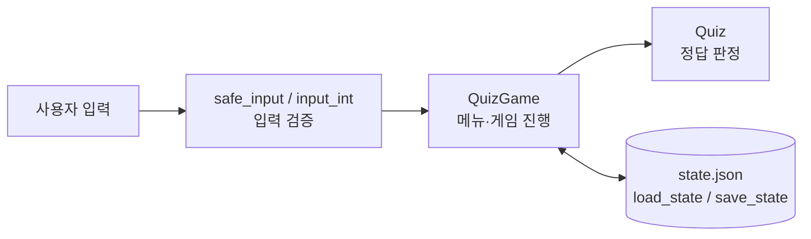

### 5-4. 변경 대상 구분 (요구사항 변경 시)

| 변경 요구 | 수정 위치 |
| --- | --- |
| 점수 계산 규칙 변경 | `QuizGame.play_quiz()` |
| 퀴즈 데이터 항목 추가 (예: 난이도) | `Quiz` 속성, `to_dict()`, `from_dict()` |
| 저장 방식 변경 (JSON → DB 등) | `load_state()`, `save_state()` |

#### 요구 변경 시 체크리스트

- [ ] 변경 대상 클래스/메서드를 위 표에서 확인했다.
- [ ] 변경한 코드가 다른 클래스의 책임을 침범하지 않는지 확인했다.
- [ ] 기존 `state.json`을 그대로 불러올 수 있는지 확인했다. (하위 호환)
- [ ] 퀴즈 풀기 / 추가 / 삭제 / 최고 점수 / 히스토리를 한 번씩 실행해 확인했다.
- [ ] 종료 후 재실행해도 데이터가 유지되는지 확인했다.
- [ ] 변경 내용을 커밋 규칙에 맞춰 커밋했다.

## 6. 파일 구조

```
kodisei-E1-2/
├── main.py                 # 퀴즈 게임 실행 및 클래스 정의
├── state.json              # 퀴즈, 최고 점수, 게임 기록 데이터
├── README.md               # 프로젝트 설명서
├── .gitignore              # Git 추적 제외 파일 설정
├── pic/
│   ├── pic1 (2).png        # python 별칭 오류 화면
│   └── pic1 (10).png       # 병합 커밋 메시지 화면
└── docs/
    └── screenshots/
        ├── python-version.png
        ├── git branch --merged.png    # 병합 커밋 목록 (git log --merges --oneline)
        ├── git-branch-log-status.png  # 브랜치·로그·상태 확인
        ├── git-clone.png              # 별도 폴더(pulltest) clone 증빙
        ├── git-graph.png              # 브랜치·병합 그래프 증빙
        ├── git-log-oneline.png        # 커밋 로그 증빙
        ├── git-pull-play.png          # 복제한 폴더(pulltest)의 git pull (변경 25개 파일 수신)
        ├── git-pull-origin-main.png   # 기존 폴더의 git pull origin main
        ├── git-push.png               # 원격 저장소 push
        ├── qize-play.png              # 퀴즈 풀이 (문제 수 선택, 힌트 사용)
        ├── quiz3.png                  # 퀴즈 목록 보기
        ├── quiz4.png                  # 최고 점수 확인
        ├── quiz-history.png           # 점수 기록 히스토리
        ├── quiz-menu-and-add.png      # 퀴즈 추가 (구버전 메뉴)
        └── quiz-play-result.png       # 최고 점수 갱신 결과 (구버전 메뉴)
```

## 7. 데이터 파일 설명: state.json

퀴즈 데이터는 프로젝트 루트의 `state.json`에 UTF-8 형식으로 저장합니다.  
프로그램을 다시 실행하면 파일을 읽어 이전에 등록한 퀴즈와 점수 정보를 복원합니다.

### 데이터 구조

```
{
  "quizzes": [
    {
      "question": "파이썬에서 변수를 만들 때 사용하는 대입 연산자는?",
      "choices": ["==", "=", ":=", "!="],
      "answer": 2,
      "hint": "변수에 값을 저장할 때 사용하는 기호입니다."
    }
  ],
  "best_score": 8,
  "history": [
    {
      "date": "2026-11-17 13:01:26",
      "total_questions": 2,
      "score": 1,
      "hint_used": 0
    }
  ]
}
```

> 위 예시는 구조 설명을 위해 퀴즈 1개만 표시했습니다. 실제 `state.json`에는 기본 퀴즈 **8개**가 등록되어 있습니다.

### 주요 필드

| 필드                | 자료형         | 설명              |
| ----------------- | ----------- | --------------- |
| `quizzes`         | list        | 등록된 퀴즈 목록       |
| `question`        | str         | 문제 내용           |
| `choices`         | list        | 4개의 선택지         |
| `answer`          | int         | 정답 번호 (1~4)     |
| `hint`            | str         | 힌트 내용           |
| `best_score`      | int 또는 null | 최고 점수           |
| `history`         | list        | 게임별 점수 기록       |
| `date`            | str         | 게임을 완료한 날짜와 시간  |
| `total_questions` | int         | 해당 게임에서 푼 문제 수  |
| `score`           | int         | 해당 게임의 획득 점수    |
| `hint_used`       | int         | 해당 게임의 힌트 사용 횟수 |

`state.json`은 실행 중 자동으로 생성 및 갱신됩니다. 파일을 직접 수정할 때는 JSON 문법(쉼표, 따옴표, 괄호)을 지켜야 합니다.

### 7-1. JSON을 선택한 이유

- **가독성:** 텍스트 편집기로 바로 열어 내용을 확인하고 수정할 수 있습니다.
- **구조화:** 퀴즈 → 선택지 목록처럼 중첩된 데이터를 `dict`/`list`로 그대로 표현할 수 있습니다.
- **표준 라이브러리:** `json` 모듈만으로 읽기/쓰기가 가능해 별도 설치가 필요 없습니다.
- **대체 형식과의 비교:**

| 형식 | 장점 | 이 프로젝트에서 선택하지 않은 이유 |
| --- | --- | --- |
| CSV | 단순한 표 형태 | 선택지 4개·힌트·기록 같은 중첩 구조 표현이 불편 |
| SQLite 등 DB | 대용량·검색·동시성에 강함 | 소규모 학습용 프로젝트에는 설정과 코드가 과함 |
| JSON | 가독성·구조화·무설치 | **채택** (데이터가 수백 건 이하일 때 적합) |

### 7-2. 데이터 로드/저장 시점

| 시점 | 동작 | 코드 |
| --- | --- | --- |
| 프로그램 시작 | `state.json`이 있으면 읽어 퀴즈·점수·기록 복원, 없으면 기본 퀴즈로 생성 | `load_state()` |
| 퀴즈 추가 직후 | 변경된 목록을 파일에 저장 | `save_state()` |
| 퀴즈 삭제 직후 | 변경된 목록을 파일에 저장 | `save_state()` |
| 퀴즈 1회 종료 직후 | 최고 점수와 게임 기록을 갱신해 저장 | `save_state()` |
| 메뉴 `0` 종료 / `Ctrl+C` / `EOFError` | 마지막으로 저장한 뒤 종료 | `save_state()` |

**실행 시나리오:** 시작(`load_state`) → 메뉴 선택 → 데이터가 바뀌는 기능 실행 직후 `save_state` → 종료 시 한 번 더 `save_state`. 따라서 비정상 종료가 발생해도 마지막 변경 작업까지는 파일에 남습니다.

### 7-3. 동시 실행 정책 (동기화/락 전략)

- 이 프로그램은 **한 번에 하나의 프로세스만 실행하는 것**을 전제로 합니다. (단일 사용자 콘솔 앱)
- 두 프로그램이 동시에 같은 `state.json`을 저장하면 나중에 저장한 쪽이 이전 변경을 덮어쓸 수 있습니다. (마지막 저장 우선)
- 현재는 별도 락을 구현하지 않았으며, 필요 시 다음 방법으로 확장할 수 있습니다.
  - **락 파일 방식:** 시작 시 `state.json.lock` 생성, 종료 시 삭제. 이미 존재하면 "다른 프로그램이 실행 중입니다" 안내 후 종료
  - **임시 파일 + 교체 방식:** `state.json.tmp`에 먼저 저장한 뒤 `os.replace()`로 교체하여 저장 도중 파일이 깨지는 것을 방지

## 8. 예외 처리 및 안전 종료

### 8-1. 파일 입출력 예외 처리

| 상황 | 예외 | 프로그램 동작 |
| --- | --- | --- |
| `state.json` 없음 | 파일 없음 확인 (`exists()`) | 기본 퀴즈 8개로 새 파일 생성 |
| JSON 문법 오류 / 값 오류 | `json.JSONDecodeError`, `ValueError` | "`state.json` 파일이 손상되었습니다." 안내 후 기본 데이터로 복구 |
| 읽기/쓰기 실패 | `OSError` | 오류 안내 후 가능한 범위에서 계속 진행 또는 종료 |

#### 권한 오류 발생 시 안내 및 복구 절차

`PermissionError`(`OSError`의 하위 예외)는 다음과 같이 처리하고 안내합니다.

1. 프로그램은 "파일을 읽거나 쓸 권한이 없습니다. 폴더 권한 또는 읽기 전용 속성을 확인해 주세요." 라는 취지로 안내합니다.
2. 사용자는 다음을 확인합니다.
   - `state.json` 파일의 **읽기 전용** 속성 해제 (파일 우클릭 → 속성)
   - 다른 프로그램(편집기 등)이 파일을 열고 있지 않은지 확인
   - 쓰기 권한이 있는 폴더(예: 사용자 문서 폴더 아래)에서 실행
3. 해결 후 프로그램을 다시 실행합니다.

### 8-2. 안전 종료 및 시그널 처리

| 종료 방식 | 처리 |
| --- | --- |
| 메뉴 `0` 입력 | 저장 후 정상 종료 |
| `Ctrl+C` (`KeyboardInterrupt`), 입력 종료 (`EOFError`) | 예외를 잡아 저장 후 안전 종료 (`SafeExit`) |
| `SIGTERM` 등 외부 종료 시그널 | **현재 직접 처리하지 않음** |

**시그널 처리의 필요성과 대응 방안:** 콘솔에서 사람이 직접 사용하는 앱이라 `Ctrl+C` 처리로 충분하지만, 서비스처럼 외부에서 프로세스를 종료하는 환경에서는 `SIGTERM`을 받을 수 있습니다. 이때는 `signal.signal(signal.SIGTERM, handler)`로 핸들러를 등록하고, 핸들러에서 `save_state()` 호출 후 종료하도록 확장할 수 있습니다. (Windows에서는 `SIGTERM` 지원이 제한적이므로 `SIGINT`/`SIGBREAK` 중심으로 처리)

## 9. 데이터 보호: 백업 및 복구 전략

현재 코드는 `state.json`이 손상되면 **기본 퀴즈 데이터로 복구**합니다. 다만 이 경우 사용자가 추가한 퀴즈와 점수 기록은 사라질 수 있으므로, 아래의 백업·복구 절차를 운영 규칙으로 정합니다.

### 9-1. 백업 정책

| 항목 | 정책 |
| --- | --- |
| 백업 시점 | 퀴즈를 추가·삭제하기 전, 그리고 중요한 변경 후 |
| 백업 파일명 | `state.json.bak` (또는 `state_YYYYMMDD.json`처럼 날짜를 붙여 버전 보존) |
| 보존 개수 | 최근 3개 정도를 보존하고 오래된 백업은 삭제 |
| Git 이력 | `state.json`도 커밋 대상이므로 Git 이력이 추가 백업 역할을 함 |

**수동 백업 명령어 (PowerShell):**

```
Copy-Item state.json state.json.bak
```

### 9-2. 복구 절차 (순서)

1. 프로그램을 종료한다.
2. 손상된 파일을 보관용으로 이름을 바꾼다: `Rename-Item state.json state.json.broken`
3. 백업 파일을 복원한다: `Copy-Item state.json.bak state.json`
4. 백업이 없다면 Git에서 이전 버전을 복원한다: `git checkout -- state.json`
5. 프로그램을 다시 실행해 퀴즈 목록과 점수 기록이 정상인지 확인한다.

### 9-3. 개선 계획 (코드 반영 예정)

`save_state()`에서 저장 직전에 기존 `state.json`을 `state.json.bak`으로 복사하는 로직을 추가하면 백업이 자동화됩니다. 현재 버전에는 자동 백업이 구현되어 있지 않으며, 위 수동 절차와 Git 이력을 대신 사용합니다.

## 10. 확장성 검토 (퀴즈 1,000개 이상)

현재 구조는 시작 시 `state.json` 전체를 메모리로 읽고, 변경 시마다 전체를 다시 저장합니다. 퀴즈가 1,000개 이상으로 늘어나는 상황을 가정해 검토했습니다.

| 항목 | 현재 방식 | 1,000개 이상일 때 영향 | 개선 방안 |
| --- | --- | --- | --- |
| 메모리 | 전체 퀴즈를 리스트로 보관 | 퀴즈 1개가 약 0.3KB 수준이면 1,000개도 약 300KB로 부담 거의 없음 | 수십만 개 이상이면 필요한 만큼만 읽도록 변경 |
| 파일 저장 시간 | 변경 때마다 전체 파일 다시 쓰기 | 수 MB 이상이면 저장이 느려질 수 있음 | 변경분만 쓰는 DB(SQLite)로 전환 |
| 목록 출력 | 전체 목록을 한 번에 출력 | 1,000줄 출력은 읽기 어려움 | **페이징**(한 번에 10개씩 보기) 적용 |
| 검색 | 순차 탐색 | 키워드 검색 시 O(n) | 분류/난이도 필드 추가 및 **인덱싱**(dict로 분류별 묶기), DB 인덱스 활용 |
| 출제 | `random`으로 전체에서 추출 | 영향 거의 없음 | 분류·난이도별 출제 옵션 추가 |

**결론:** 1,000개 수준까지는 현재 JSON 방식으로도 동작에 큰 문제가 없으며, 그 이상에서는 **목록 페이징 → 분류 필드 추가 → SQLite 전환** 순서로 단계적으로 개선할 계획입니다.

## 11. Git 버전 관리

기능을 단계별로 개발하고 Git으로 변경 이력을 관리했습니다.

### 11-1. 사용한 주요 명령어

| 명령어                               | 용도                |
| --------------------------------- | ----------------- |
| `git init`                        | 로컬 저장소 초기화        |
| `git add`                         | 변경 파일을 스테이징       |
| `git commit`                      | 변경 내용 저장          |
| `git branch`                      | 브랜치 확인 및 생성       |
| `git checkout`                    | 브랜치 이동            |
| `git merge`                       | 브랜치 병합            |
| `git push`                        | 원격 저장소에 업로드       |
| `git pull`                        | 원격 저장소 변경 사항 가져오기 |
| `git clone`                       | 원격 저장소 복제         |
| `git status`                      | 작업 디렉터리 상태 확인     |
| `git log --oneline --graph --all` | 커밋 및 브랜치 이력 확인    |

### 11-2. 커밋 규칙

#### 커밋 단위 기준

- **하나의 커밋에는 하나의 목적**만 담습니다. (기능 1개 추가, 버그 1개 수정, 문서 1건 보완 등)
- 서로 관련 없는 변경(예: 기능 추가 + 오타 수정)은 커밋을 나눕니다.
- 실행 가능한 상태에서 커밋하며, 커밋 전 `py main.py`로 동작을 확인합니다.

#### 커밋 메시지 템플릿

```
타입: 변경 내용 요약 (한 줄, 50자 내외)
```

| 타입 | 의미 | 예시 |
| --- | --- | --- |
| `Feat` | 새 기능 추가 | `Feat: 힌트 기능 추가` |
| `Fix` | 버그 수정 | `Fix: 빈 입력 처리 오류 수정` |
| `Docs` | 문서 수정 | `Docs: README 실행 방법 보완` |
| `Refactor` | 동작 변경 없는 코드 개선 | `Refactor: 입력 검증 함수 분리` |
| `Data` | 데이터 파일 변경 | `Data: 기본 퀴즈 8개로 확장` |
| `Chore` | 설정·기타 작업 | `Chore: .gitignore 추가` |

### 11-3. 커밋 이력 증빙 (의미 있는 커밋 10개 이상)

현재 저장소의 `main` 브랜치에는 **20개의 커밋**(병합 커밋 2개 포함)이 있습니다. 커밋 로그는 아래 명령어로 확인할 수 있습니다.

```
git log --oneline
git rev-list --count HEAD
```

커밋 로그 화면:

[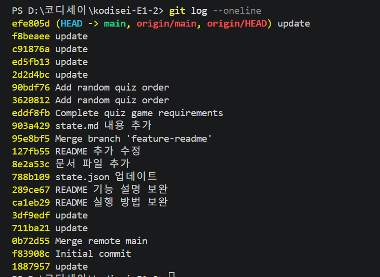](https://github.com/kodisei889-dev/kodisei-E1-2/blob/main/docs/screenshots/git-log-oneline.png)

로그에서 확인되는 주요 커밋은 다음과 같습니다.

| 커밋 | 메시지 | 내용 |
| --- | --- | --- |
| `f83908c` | Initial commit | 저장소 최초 생성 |
| `ca1eb29` | README 실행 방법 보완 | 문서: 실행 방법 |
| `289ce67` | README 기능 설명 보완 | 문서: 기능 설명 |
| `788b109` | state.json 업데이트 | 데이터 파일 갱신 |
| `8e2a53c` | 문서 파일 추가 | 문서 추가 |
| `127fb55` | README 추가 수정 | `feature-readme` 브랜치 작업 |
| `903a429` | state.md 내용 추가 | 문서: 상태 설명 |
| `eddf8fb` | Complete quiz game requirements | 퀴즈 게임 요구사항 완성 |
| `3620812` | Add random quiz order | 문제 랜덤 출제 추가 |
| `90bdf76` | Add random quiz order | 문제 랜덤 출제 보완 |

> 이 외에 메시지가 `update`인 커밋이 있습니다. 위 11-2의 커밋 규칙은 이후 커밋부터 적용합니다.

GitHub 커밋 목록: <https://github.com/kodisei889-dev/kodisei-E1-2/commits/main/>

### 11-4. 브랜치 생성 및 병합

```
# 기능 브랜치 생성 및 이동
git checkout -b feature-readme

# README 변경 사항 등록 및 커밋
git add README.md
git commit -m "Docs: README 실행 방법 보완"

# main 브랜치로 이동
git checkout main

# 기능 브랜치 병합
git merge feature-readme

# GitHub에 업로드
git push origin main
```

#### 작업 이력 확인

```
git branch
git log --oneline --graph --all
git status
```

브랜치 병합 및 원격 저장소 push 작업 화면:

[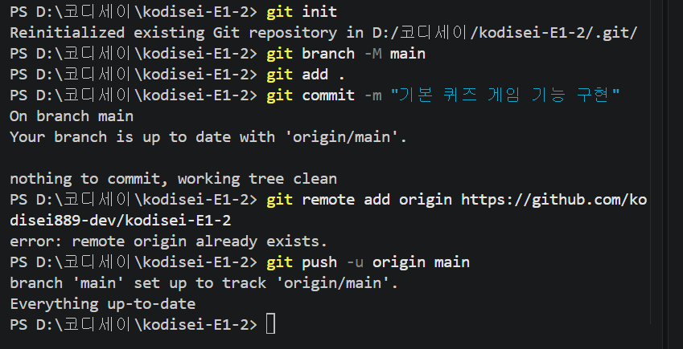](https://github.com/kodisei889-dev/kodisei-E1-2/blob/main/docs/screenshots/git-push.png)

[](https://github.com/kodisei889-dev/kodisei-E1-2/blob/main/docs/screenshots/git-branch-log-status.png)

#### 브랜치·병합 그래프 증빙

`git log --oneline --graph --all` 실행 결과(브랜치 분기와 병합 표시):

[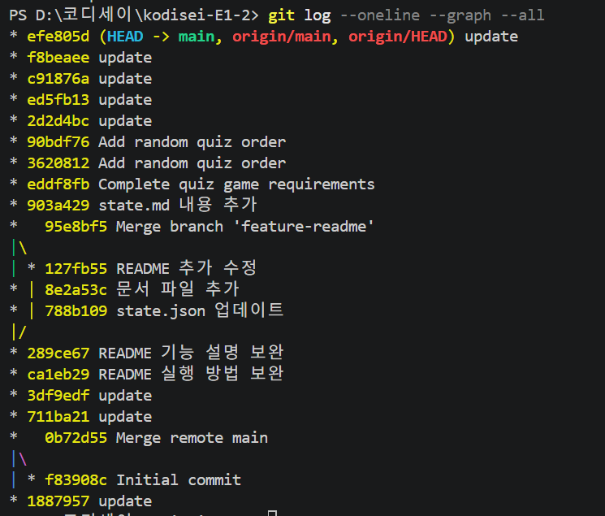](https://github.com/kodisei889-dev/kodisei-E1-2/blob/main/docs/screenshots/git-graph.png)

위 그래프에서 `feature-readme` 브랜치가 `main`에서 갈라졌다가 `95e8bf5 Merge branch 'feature-readme'` 커밋으로 병합된 이력을 확인할 수 있습니다. `0b72d55 Merge remote main`은 원격 `main`과 로컬 `main`을 병합한 커밋입니다.

병합 커밋만 따로 확인한 화면 (`git log --merges --oneline`):

[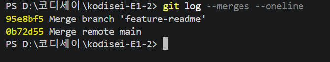](https://github.com/kodisei889-dev/kodisei-E1-2/blob/main/docs/screenshots/git%20branch%20--merged.png)

`feature-readme` 브랜치를 `main`에 병합할 때 자동으로 열린 병합 커밋 메시지 화면:

[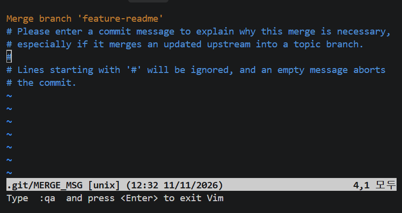](https://github.com/kodisei889-dev/kodisei-E1-2/blob/main/pic/pic1%20%2810%29.png)

### 11-5. clone / pull 실습 증빙

원격 저장소를 별도 폴더(`pulltest`)에 복제한 뒤, 기존 작업 폴더에서 변경한 내용을 push하고 복제한 폴더에서 `git pull`로 받아오는 과정을 실습했습니다.

| 단계 | 폴더 | 명령어 | 결과 |
| --- | --- | --- | --- |
| 1 | 별도 폴더 `pulltest` | `git clone https://github.com/kodisei889-dev/kodisei-E1-2.git` | 원격 저장소 복제 완료 (79개 객체) |
| 2 | 기존 작업 폴더 `kodisei-E1-2` | README, 스크린샷, `state.json` 수정 후 `main`에 push | 원격 `main`이 `efe805d`에서 `c1c7327`로 갱신 |
| 3 | 복제한 폴더 `pulltest\kodisei-E1-2` | `git pull` | **Fast-forward** `efe805d..c1c7327`, 25개 파일 변경 |
| 4 | 기존 작업 폴더 `kodisei-E1-2` | `git pull origin main` | `Already up to date.` (이미 최신) |

3단계에서 기존 폴더에서 push한 변경 사항(README 수정, 스크린샷 추가, `state.json` 갱신)이 복제한 폴더로 그대로 들어온 것을 확인했습니다.

`pulltest` 폴더에서 `git clone` 수행 화면:

[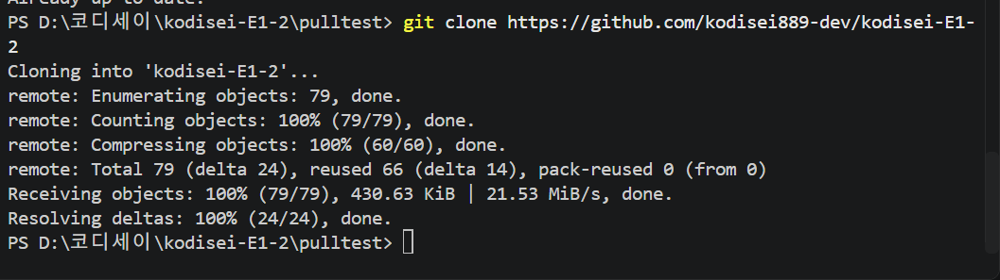](https://github.com/kodisei889-dev/kodisei-E1-2/blob/main/docs/screenshots/git-clone.png)

복제한 폴더에서 `git pull`로 변경 사항을 받아온 화면 (Fast-forward, 25 files changed):

[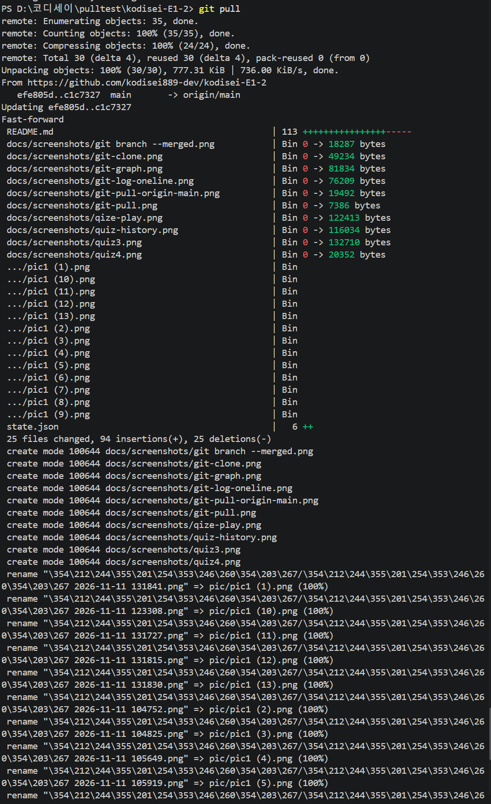](https://github.com/kodisei889-dev/kodisei-E1-2/blob/main/docs/screenshots/git-pull-play.png)

기존 작업 폴더에서 `git pull origin main` 수행 화면:

[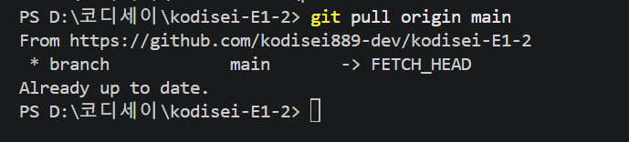](https://github.com/kodisei889-dev/kodisei-E1-2/blob/main/docs/screenshots/git-pull-origin-main.png)

> 실제로 수행한 작업만 기재합니다. 위 화면은 실습 중 촬영한 캡처입니다.

## 12. 실행 화면

### 퀴즈 메뉴 및 퀴즈 추가

[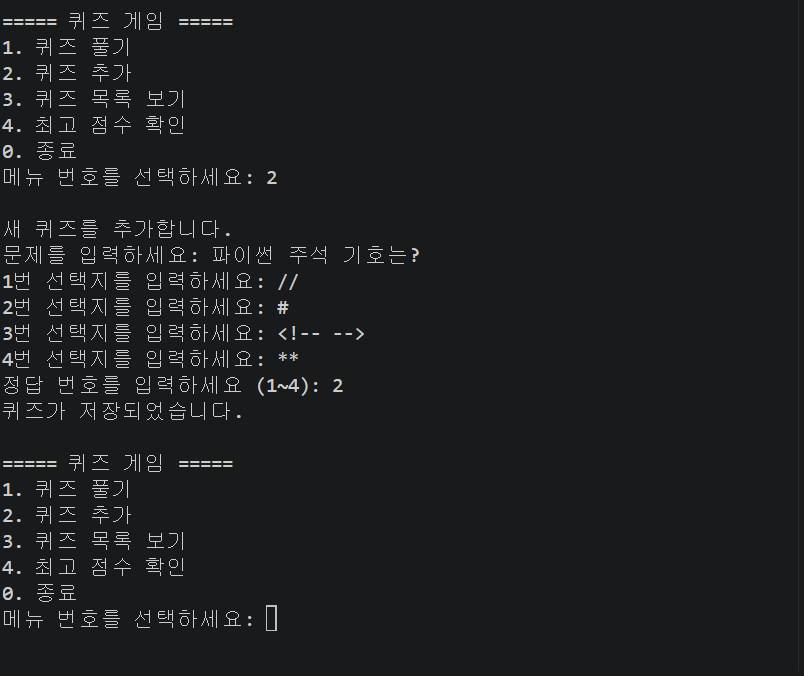](https://github.com/kodisei889-dev/kodisei-E1-2/blob/main/docs/screenshots/quiz-menu-and-add.png)

### 퀴즈 풀이 및 결과 (문제 수 선택, 힌트 사용)

[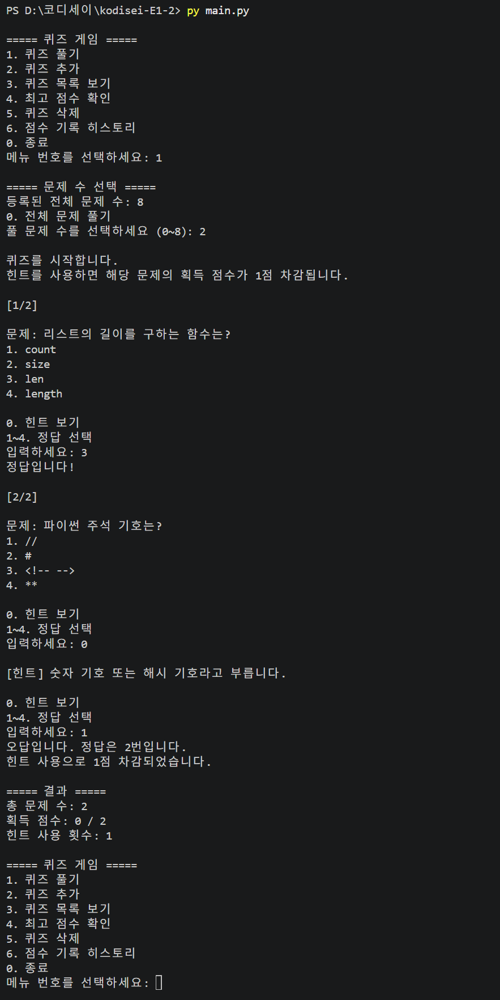](https://github.com/kodisei889-dev/kodisei-E1-2/blob/main/docs/screenshots/qize-play.png)

### 최고 점수 갱신 결과

[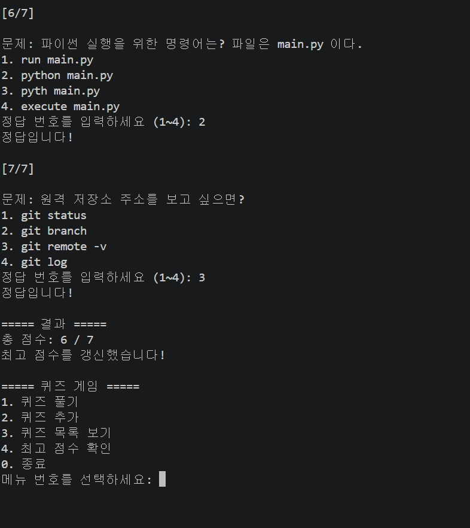](https://github.com/kodisei889-dev/kodisei-E1-2/blob/main/docs/screenshots/quiz-play-result.png)

### 퀴즈 목록 보기

[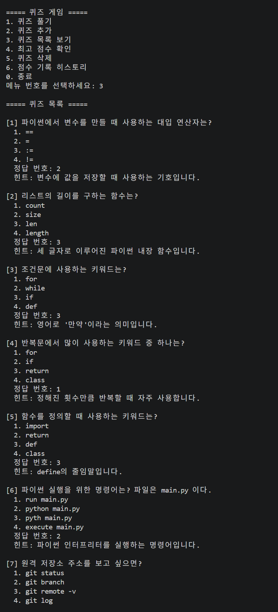](https://github.com/kodisei889-dev/kodisei-E1-2/blob/main/docs/screenshots/quiz3.png)

### 최고 점수 확인

[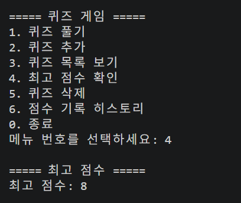](https://github.com/kodisei889-dev/kodisei-E1-2/blob/main/docs/screenshots/quiz4.png)

### 점수 기록 히스토리

[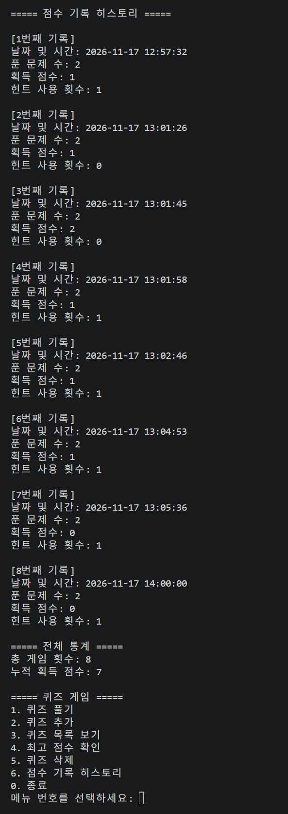](https://github.com/kodisei889-dev/kodisei-E1-2/blob/main/docs/screenshots/quiz-history.png)

> 위 스크린샷은 기능 개발 과정에서 촬영한 실제 터미널 화면입니다. 퀴즈 추가 화면(`quiz-menu-and-add.png`)은 삭제·점수 히스토리 메뉴를 추가하기 전 버전이며, 현재 메뉴와 출력 내용은 실행 중인 최신 코드 기준으로 확인할 수 있습니다.

## 13. 과제 제출 전 확인 사항

- [ ] GitHub 저장소 URL을 제출한다.
- [ ] `main.py`, `state.json`, `README.md`, `.gitignore`가 저장소에 포함되어 있는지 확인한다.
- [ ] 기본 퀴즈가 5개 이상(현재 8개) 등록되어 있는지 확인한다.
- [ ] 퀴즈 추가 후 프로그램을 재실행해도 데이터가 유지되는지 확인한다.
- [ ] 퀴즈 풀이, 목록, 최고 점수, 삭제, 히스토리 기능을 확인한다.
- [ ] Git 커밋이 의미 있는 내용으로 10개 이상인지 확인하고 커밋 로그 캡처를 첨부한다.
- [ ] 브랜치 생성 및 병합 이력을 `git log --graph` 캡처로 첨부한다.
- [ ] 별도 폴더에 `git clone`한 뒤 변경 사항을 push하고, 기존 폴더에서 `git pull`하는 실습을 완료하고 캡처를 첨부한다.
- [ ] 최신 코드 기준 메뉴, 퀴즈 추가, 퀴즈 풀이, 점수 기록 화면을 캡처한다.

---

## 마무리

이번 프로젝트를 통해 Python 기본 문법을 활용해 하나의 콘솔 프로그램을 완성하고, 클래스를 이용한 코드 구조화와 JSON 파일을 통한 데이터 저장을 경험했습니다. 또한 Git의 커밋, 브랜치, 병합, 원격 저장소 연동 과정을 실습하며 개발 과정과 변경 이력을 관리하는 방법을 학습했습니다.