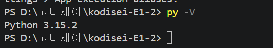
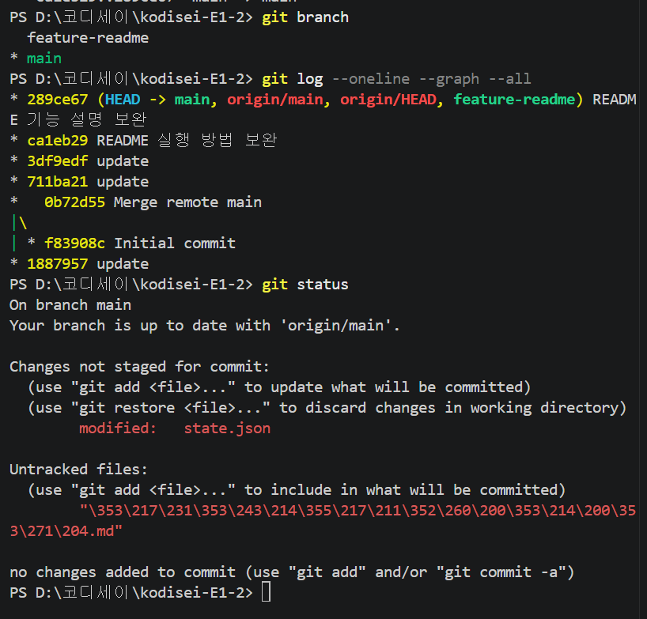

# 나만의 파이썬 퀴즈 게임

Python 기초 문법과 Git 사용법을 익히기 위해 만든 콘솔 기반 퀴즈 게임입니다.  
사용자는 등록된 퀴즈를 풀거나 새로운 문제를 추가할 수 있으며, 퀴즈와 점수 기록은 JSON 파일에 저장되어 프로그램을 다시 실행해도 유지됩니다.

## 1. 프로젝트 개요

이 프로젝트는 파이썬의 기본 문법을 실제 프로그램에 적용하는 것을 목표로 제작했습니다.

- **프로젝트 유형:** Python 콘솔 애플리케이션
- **퀴즈 주제:** Python 및 Git 기초
- **주요 기술:** Python, 클래스와 객체, 예외 처리, JSON 파일 입출력, Git/GitHub
- **외부 라이브러리:** 사용하지 않음 (Python 표준 라이브러리만 사용)

### 퀴즈 주제 선정 이유

개발 입문 과정에서 자주 사용하는 Python 문법과 Git 명령어를 문제로 구성했습니다.  
문제를 풀면서 변수, 리스트, 조건문, 반복문, 함수와 같은 파이썬 기초 개념을 복습하고, `git status`, `git branch`, `git remote -v` 등의 Git 명령어도 함께 익힐 수 있도록 주제를 선정했습니다.

## 2. 개발 환경

| 항목 | 내용 |
|---|---|
| 운영체제 | Windows |
| 언어 | Python 3.10 이상 |
| 개발 도구 | Visual Studio Code 또는 터미널 |
| 실행 환경 | PowerShell |
| 데이터 저장 | JSON (UTF-8) |
| 버전 관리 | Git / GitHub |

개발 환경 확인 화면:



> 개발 당시 Windows에서 `python` 명령이 Microsoft Store 실행 별칭으로 연결되는 문제가 있었습니다. 해당 환경에서는 Python Launcher 명령인 `py`로 실행했습니다.

## 3. 실행 방법

### 3-1. 저장소 복제

```bash
git clone https://github.com/kodisei889-dev/kodisei-E1-2.git
cd kodisei-E1-2
```

### 3-2. Python 버전 확인

```powershell
py --version
```

Python 3.10 이상이 설치되어 있어야 합니다.

### 3-3. 프로그램 실행

Windows PowerShell에서는 다음 명령어로 실행할 수 있습니다.

```powershell
py main.py
```

`python` 명령이 정상적으로 등록된 환경이라면 아래 명령어도 사용할 수 있습니다.

```bash
python main.py
```

별도의 패키지 설치는 필요하지 않습니다.

## 4. 주요 기능

프로그램 메뉴에서 번호를 입력해 기능을 선택합니다.

| 메뉴 | 기능 | 설명 |
|---|---|---|
| 1 | 퀴즈 풀기 | 전체 문제 또는 원하는 문제 수만큼 랜덤으로 출제 |
| 2 | 퀴즈 추가 | 문제, 선택지 4개, 정답 번호, 힌트 등록 |
| 3 | 퀴즈 목록 보기 | 등록된 문제와 선택지, 정답 및 힌트 확인 |
| 4 | 최고 점수 확인 | 저장된 최고 점수 확인 |
| 5 | 퀴즈 삭제 | 선택한 퀴즈 삭제 후 JSON 파일에 반영 |
| 6 | 점수 기록 히스토리 | 게임 날짜/시간, 푼 문제 수, 점수, 힌트 사용 횟수 확인 |
| 0 | 종료 | 데이터를 저장하고 프로그램 종료 |

### 4-1. 퀴즈 출제 및 문제 수 선택

- 등록된 문제 중 풀 문제 수를 선택할 수 있습니다.
- `0`을 선택하면 전체 문제를 풉니다.
- 문제 순서는 무작위로 섞입니다.
- 정답 또는 오답 여부를 즉시 확인할 수 있습니다.

### 4-2. 힌트 및 점수 계산

각 퀴즈에는 힌트가 포함될 수 있으며, 문제를 푸는 도중 `0`을 입력하면 힌트를 확인할 수 있습니다.

점수 규칙은 다음과 같습니다.

| 풀이 결과 | 점수 변화 |
|---|---:|
| 힌트 없이 정답 | +1점 |
| 힌트 사용 후 정답 | 0점 (정답 +1점, 힌트 -1점) |
| 힌트 없이 오답 | 0점 |
| 힌트 사용 후 오답 | -1점 |

힌트는 한 문제에서 한 번만 사용할 수 있습니다. 힌트 사용에 따른 감점은 정답 여부와 관계없이 적용됩니다.

### 4-3. 퀴즈 추가 및 삭제

- 문제와 선택지 4개를 입력해 새 퀴즈를 등록합니다.
- 정답 번호는 1~4 중에서 선택합니다.
- 힌트는 선택적으로 입력할 수 있습니다.
- 삭제할 퀴즈 번호를 선택하고 확인 절차를 거쳐 삭제합니다.
- 추가 및 삭제 결과는 `state.json`에 저장됩니다.

### 4-4. 점수 기록

게임이 끝날 때마다 다음 항목을 기록합니다.

- 게임 실행 날짜 및 시간
- 푼 문제 수
- 획득 점수
- 힌트 사용 횟수

최고 점수와 전체 게임 기록을 각각 확인할 수 있습니다.

### 4-5. 입력 및 예외 처리

- 입력 앞뒤 공백을 제거합니다.
- 숫자가 아닌 값이나 허용 범위를 벗어난 값은 안내 후 다시 입력받습니다.
- 빈 입력을 처리합니다.
- `Ctrl+C` 또는 입력 종료(`EOFError`)가 발생하면 저장을 시도한 뒤 안전하게 종료합니다.
- `state.json`이 없거나 손상된 경우 기본 퀴즈 데이터로 복구를 시도합니다.

## 5. 코드 구조

프로그램은 역할에 따라 `Quiz`와 `QuizGame` 두 클래스로 구성했습니다.

### Quiz 클래스

개별 퀴즈 한 개의 데이터를 관리합니다.

| 속성 / 메서드 | 역할 |
|---|---|
| `question` | 문제 내용 |
| `choices` | 4개의 선택지 |
| `answer` | 정답 번호 (1~4) |
| `hint` | 문제의 힌트 |
| `display()` | 문제와 선택지 출력 |
| `show_hint()` | 힌트 출력 |
| `is_correct()` | 사용자 답안의 정답 여부 확인 |
| `to_dict()` | 퀴즈 객체를 JSON 저장용 딕셔너리로 변환 |
| `from_dict()` | 딕셔너리 데이터를 Quiz 객체로 변환 |

### QuizGame 클래스

퀴즈 게임 전체 흐름과 데이터를 관리합니다.

| 메서드 | 역할 |
|---|---|
| `load_state()` | JSON 파일에서 퀴즈와 점수 기록 불러오기 |
| `save_state()` | 퀴즈, 최고 점수, 게임 기록 저장 |
| `show_menu()` | 메인 메뉴 출력 |
| `play_quiz()` | 문제 출제, 답안 확인, 점수 계산 |
| `select_question_count()` | 출제할 문제 수 선택 |
| `add_quiz()` | 퀴즈 추가 |
| `delete_quiz()` | 퀴즈 삭제 |
| `show_quiz_list()` | 등록된 퀴즈 목록 출력 |
| `show_best_score()` | 최고 점수 출력 |
| `show_history()` | 게임 기록 및 통계 출력 |
| `safe_input()` | 키보드 인터럽트 및 입력 종료 처리 |
| `input_int()` | 숫자 입력과 범위 검증 |

## 6. 파일 구조

```text
kodisei-E1-2/
├── main.py                 # 퀴즈 게임 실행 및 클래스 정의
├── state.json              # 퀴즈, 최고 점수, 게임 기록 데이터
├── README.md               # 프로젝트 설명서
├── .gitignore              # Git 추적 제외 파일 설정
└── docs/
    └── screenshots/
        ├── python-version.png
        ├── quiz-menu-and-add.png
        ├── quiz-play-result.png
        ├── git-push.png
        └── git-branch-log-status.png
```

## 7. 데이터 파일 설명: state.json

퀴즈 데이터는 프로젝트 루트의 `state.json`에 UTF-8 형식으로 저장합니다.  
프로그램을 다시 실행하면 파일을 읽어 이전에 등록한 퀴즈와 점수 정보를 복원합니다.

### 데이터 구조

```json
{
  "quizzes": [
    {
      "question": "파이썬에서 변수를 만들 때 사용하는 대입 연산자는?",
      "choices": ["==", "=", ":=", "!="],
      "answer": 2,
      "hint": "변수에 값을 저장할 때 사용하는 기호입니다."
    }
  ],
  "best_score": 8,
  "history": [
    {
      "date": "2026-11-17 13:01:26",
      "total_questions": 2,
      "score": 1,
      "hint_used": 0
    }
  ]
}
```

### 주요 필드

| 필드 | 자료형 | 설명 |
|---|---|---|
| `quizzes` | list | 등록된 퀴즈 목록 |
| `question` | str | 문제 내용 |
| `choices` | list | 4개의 선택지 |
| `answer` | int | 정답 번호 (1~4) |
| `hint` | str | 힌트 내용 |
| `best_score` | int 또는 null | 최고 점수 |
| `history` | list | 게임별 점수 기록 |
| `date` | str | 게임을 완료한 날짜와 시간 |
| `total_questions` | int | 해당 게임에서 푼 문제 수 |
| `score` | int | 해당 게임의 획득 점수 |
| `hint_used` | int | 해당 게임의 힌트 사용 횟수 |

`state.json`은 실행 중 자동으로 생성 및 갱신됩니다. 파일을 직접 수정할 때는 JSON 문법(쉼표, 따옴표, 괄호)을 지켜야 합니다.

## 8. Git 버전 관리

기능을 단계별로 개발하고 Git으로 변경 이력을 관리했습니다.

### 사용한 주요 명령어

| 명령어 | 용도 |
|---|---|
| `git init` | 로컬 저장소 초기화 |
| `git add` | 변경 파일을 스테이징 |
| `git commit` | 변경 내용 저장 |
| `git branch` | 브랜치 확인 및 생성 |
| `git checkout` | 브랜치 이동 |
| `git merge` | 브랜치 병합 |
| `git push` | 원격 저장소에 업로드 |
| `git pull` | 원격 저장소 변경 사항 가져오기 |
| `git clone` | 원격 저장소 복제 |
| `git status` | 작업 디렉터리 상태 확인 |
| `git log --oneline --graph --all` | 커밋 및 브랜치 이력 확인 |

### 브랜치 생성 및 병합 예시

```bash
# 기능 브랜치 생성 및 이동
git checkout -b feature-readme

# README 변경 사항 등록 및 커밋
git add README.md
git commit -m "Docs: README 실행 방법 보완"

# main 브랜치로 이동
git checkout main

# 기능 브랜치 병합
git merge feature-readme

# GitHub에 업로드
git push origin main
```

### 작업 이력 확인

```bash
git branch
git log --oneline --graph --all
git status
```

브랜치 병합 및 원격 저장소 push 작업 화면:




> 과제 제출 전 GitHub 저장소에서 의미 있는 커밋 10개 이상, 브랜치 생성 및 병합, clone과 pull 실행 이력이 모두 확인되는지 점검합니다. 실제 수행하지 않은 작업은 완료했다고 기재하지 않습니다.

## 9. 실행 화면

### 퀴즈 메뉴 및 퀴즈 추가


### 퀴즈 풀이 및 결과


> 위 스크린샷은 기능 개발 과정에서 촬영한 실제 터미널 화면입니다. 일부 화면은 문제 수 선택, 힌트, 삭제, 점수 히스토리 기능을 추가하기 전 버전일 수 있으며, 현재 메뉴와 출력 내용은 실행 중인 최신 코드 기준으로 확인할 수 있습니다.

## 10. 과제 제출 전 확인 사항

- [ ] GitHub 저장소 URL을 제출한다.
- [ ] `main.py`, `state.json`, `README.md`, `.gitignore`가 저장소에 포함되어 있는지 확인한다.
- [ ] 기본 퀴즈가 5개 이상 등록되어 있는지 확인한다.
- [ ] 퀴즈 추가 후 프로그램을 재실행해도 데이터가 유지되는지 확인한다.
- [ ] 퀴즈 풀이, 목록, 최고 점수, 삭제, 히스토리 기능을 확인한다.
- [ ] Git 커밋이 의미 있는 내용으로 10개 이상인지 확인한다.
- [ ] 브랜치 생성 및 병합 이력을 확인한다.
- [ ] 별도 폴더에 `git clone`한 뒤 변경 사항을 push하고, 기존 폴더에서 `git pull`하는 실습을 완료한다.
- [ ] 최신 코드 기준 메뉴, 퀴즈 추가, 퀴즈 풀이, 점수 기록 화면을 캡처한다.

---

## 마무리

이번 프로젝트를 통해 Python 기본 문법을 활용해 하나의 콘솔 프로그램을 완성하고, 클래스를 이용한 코드 구조화와 JSON 파일을 통한 데이터 저장을 경험했습니다. 또한 Git의 커밋, 브랜치, 병합, 원격 저장소 연동 과정을 실습하며 개발 과정과 변경 이력을 관리하는 방법을 학습했습니다.
